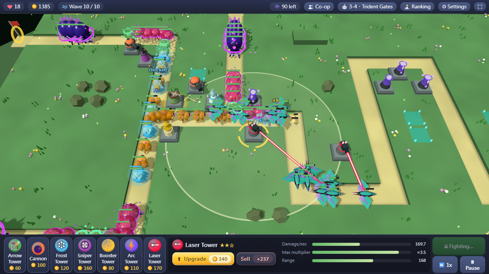
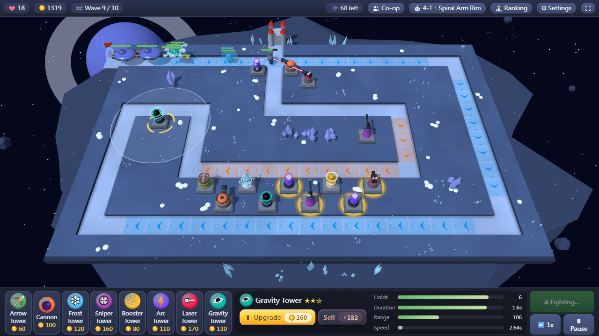

# Tower Asteroid 2 塔防小行星 2 — preview

An in-development preview of the second Tower Asteroid game. It changes often and may be unbalanced. The finished game will be sold on itch.io.

**▶ Try the preview:** [GitHub Pages](https://m9921039-ctrl.github.io/tower-asteroid-2-play/) · Free first game: [itch.io](https://milojan.itch.io/tower-asteroid)

Monsters march along winding roads toward your castle, from the Milky Way out to the Whirlpool Galaxy. Build towers beside the road to stop them, survive 10 waves to clear a map, and collect stars to unlock the next galaxy.

- **20 maps in 4 galaxies**: Milky Way, Andromeda, Triangulum and Whirlpool, five maps each, from Easy to Very Hard
- **Stars**: the more lives you have left when you win, the more stars (up to ★★★ per map); collect 10 ★ in a galaxy to unlock all five maps of the next one
- **8 towers**, each upgradable to Lv.3: Arrow, Cannon, Frost, Sniper and Booster, plus the chain-lightning **Arc Tower** (from Andromeda), the **Laser Tower** whose beam ignores shields and armor (from Triangulum) and the **Gravity Tower** that drags enemies back (from Whirlpool)
- **New monsters**: Splitters that break into shards, Medics that heal their friends, Shields that block weak hits, Armored enemies and Carriers that launch drones
- **New terrain**: high ground, tunnels, portals, energy tiles, currents, stargates, dark nebulae and gravity vortexes
- **Online 2-player co-op**: create a room, share the 5-character code, defend together (peer-to-peer)
- **Global leaderboard**: the lives you have left on each map are your score, 400 points for a perfect run of all 20 maps
- **Music and sound effects**, each with its own switch and volume in ⚙ Settings
- **4 languages**: English, 繁體中文, 简体中文, 日本語 (follows your browser, changeable in ⚙ Settings)
- Works with mouse or touch; press `F` for fullscreen

## Controls

| Input | Action |
|---|---|
| Pick a tower below, then click the grass | Build (hold `Shift` to keep building) |
| Click a tower | Upgrade or sell |
| Select a tower, then right-click an enemy | That tower attacks this enemy first |
| Right-drag / mouse wheel | Move / zoom the camera (arrow keys or `W` `A` `S` `D`, `+` / `-` also work) |
| `1` – `8` | Choose a tower type |
| `Space` | Start the next wave |
| `U` / `P` / `Esc` | Upgrade / pause / deselect |
| `M` | Mute or unmute all sound |
| `Enter` | Chat with your partner in co-op |
| `F` | Fullscreen |

---

《塔防小行星》的第二代，打開瀏覽器就能玩的 3D 塔防遊戲。敵人沿著蜿蜒的道路進攻城堡，在路旁蓋防禦塔擋住他們；每張地圖撐過 10 波就過關，過關剩下的生命換成星星，一個星系累積 10 顆★就解鎖下一個星系。

- **四個星系、二十張地圖**：銀河系、仙女座星系、三角座星系、漩渦星系，每個星系五張，從簡單到極難
- **八種塔**，都能升到 Lv.3：弓箭塔、砲塔、冰霜塔、狙擊塔、增幅塔，加上會連鎖跳躍的**電弧塔**（仙女座星系起）、光束不受護盾和裝甲影響的**雷射塔**（三角座星系起）、把敵人拉回去的**引力塔**（漩渦星系起）
- **新的怪物**：被打倒會裂成碎片的分裂怪、幫同伴回血的治療怪、擋下弱攻擊的護盾怪、裝甲怪、沿路放出無人機的母艦
- **新的地形**：高台、隧道、傳送門、能量格、漩渦洋流、星門、暗星雲、引力漩渦
- 線上雙人合作、全球積分排行（二十張滿分 400）、背景音樂和音效，支援繁中、简中、English、日本語

這是第二代開發中的試玩版，內容會常常更新，難度也還在調整；完成後會在 itch.io 販售。

**▶ 試玩：** [GitHub Pages](https://m9921039-ctrl.github.io/tower-asteroid-2-play/) · 免費的第一代：[itch.io](https://milojan.itch.io/tower-asteroid)

Made with HTML5, JavaScript and [three.js](https://threejs.org/).

## License

© 2026 MiloJan. All rights reserved. This repository only hosts the playable preview. It is **not** open source: you are welcome to try it, but you may not copy, modify, redistribute or re-host it without permission. See [LICENSE.txt](LICENSE.txt).

本遊戲歡迎免費遊玩，但不是開放原始碼，作者保留所有權利；未經許可不得重製、修改、散布或轉載。
